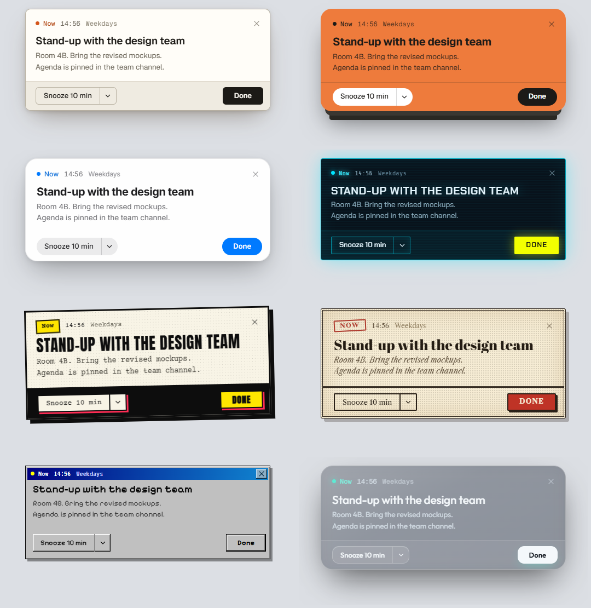
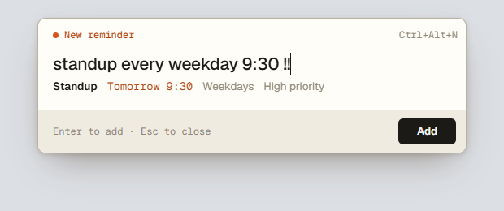
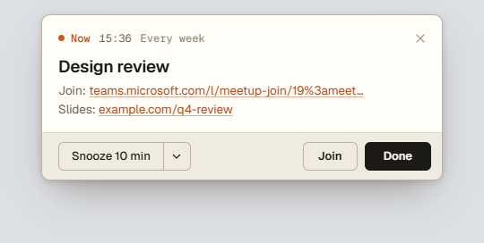
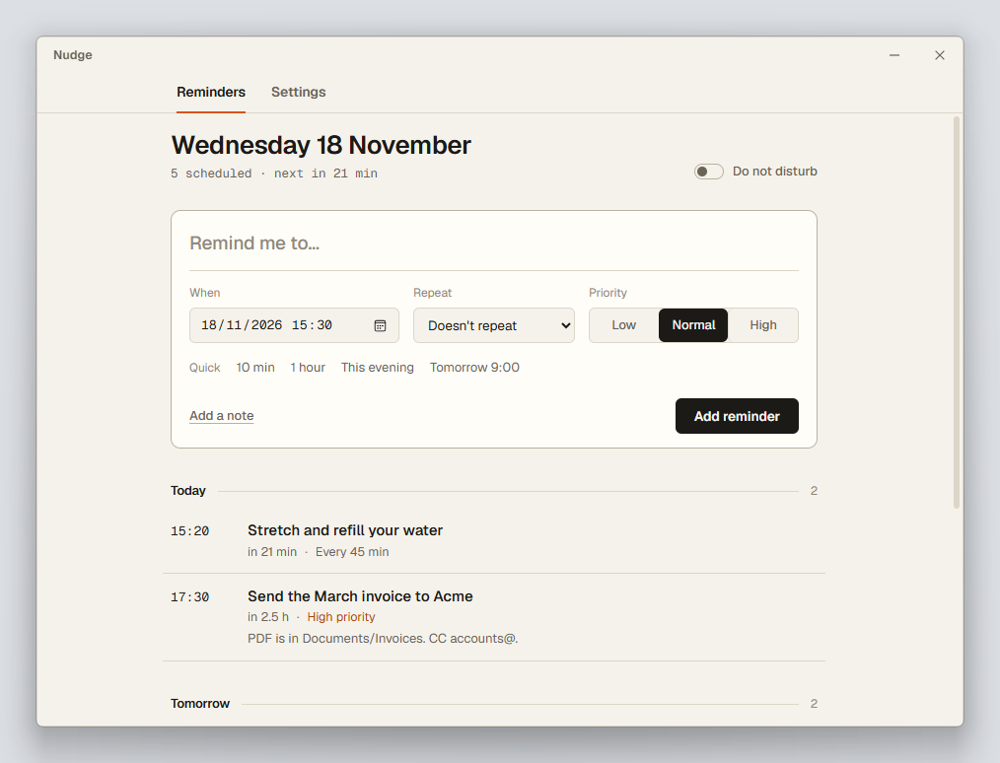
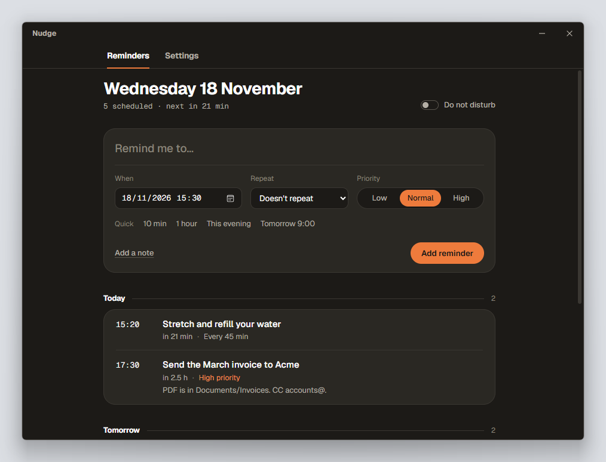
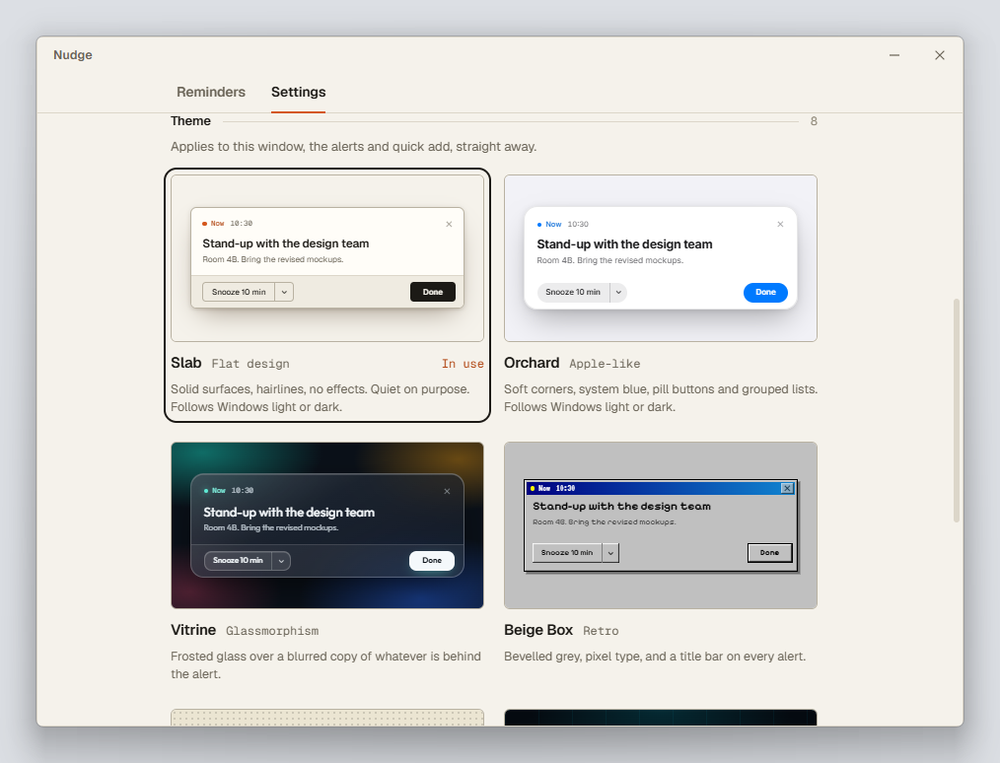

<h1 align="center">Nudge</h1>

<p align="center">
  <strong>Reminders for Windows that wait for an answer.</strong><br>
  When one comes due, a card drops in at the top of your screen and stays there until you press
  <em>Done</em> or <em>Snooze</em>. It never steals the keyboard from what you're typing.
</p>

<p align="center">
  <a href="../../releases/latest"><strong>Download for Windows</strong></a>
  &nbsp;·&nbsp; Windows 10 / 11 &nbsp;·&nbsp; free and open source &nbsp;·&nbsp; works offline
</p>

<p align="center">
  
</p>

## Why

Windows notifications are made to be missed. A toast slides in, waits a few seconds, and disappears into
the notification centre, or never shows at all while Focus Assist is on. That's fine for an email. It's
not fine for "call the bank before 5" or "take your pills".

Nudge treats a reminder as something you must answer:

- **It stays on screen** until you press *Done*, *Snooze* or ✕. Missed ones are still waiting when you get back.
- **It doesn't interrupt your typing.** The card floats above everything but never takes keyboard focus.
- **It stays out of your presentations.** During a full-screen app, game or slideshow, alerts wait until you're
  done, and they never show up in a screen share or recording.
- **Snoozing doesn't break repeats.** Snooze your 9:00 stand-up to 9:10, and tomorrow's is still at 9:00.
- **Nothing leaves your PC.** No account, no cloud, no telemetry. One small SQLite file.

## Features

- **Quick add from anywhere.** Press <kbd>Ctrl</kbd>+<kbd>Alt</kbd>+<kbd>N</kbd> and type it the way you'd
  say it: `call mom tomorrow 5pm`, `stretch in 20 min`, `standup every weekday 9:30`, `pay rent nov 1 !!`.
- **Repeats:** every day, weekdays, weekly, monthly, or every *N* minutes / hours.
- **Snooze** for 10 min with one click, or 5 min, 15 min, 30 min, 1 hour or tomorrow 9:00.
- **Notes** with line breaks and clickable links, shown on the alert (with *Show more* for long ones). A Teams,
  Zoom, Meet or Webex link in the note adds a **Join** button.
- **Answer from the keyboard:** <kbd>Ctrl</kbd>+<kbd>Alt</kbd>+<kbd>D</kbd> marks the alert done,
  <kbd>Ctrl</kbd>+<kbd>Alt</kbd>+<kbd>S</kbd> snoozes it, from any app (only while an alert is on screen).
- **Ring again** every 2–15 minutes until you answer, if you want it to.
- **Quiet during presentations:** full-screen apps, games and slideshows hold alerts back (high priority still
  gets through), and alerts are invisible to screen sharing and recording apps.
- **Backup:** export every reminder to a JSON file and import it on another PC, without duplicates.
- **Priorities:** high-priority alerts get a stronger chime and go first when several are waiting.
- **Do not disturb:** reminders hold back and arrive the moment you turn it off.
- **Reliable timing:** correct across sleep, clock changes and restarts. Anything that came due while the PC
  was off shows up as soon as Nudge starts.
- **Tray icon** that shows what's next ("Standup in 12 min") and turns red when an alert is waiting.
- **Eight themes**, from quiet flat design to frosted glass, punk flyer and Windows 95.
- **Small and native:** a ~5 MB installer, no admin rights, no Electron.

<p align="center">
  
  
</p>

<p align="center">
  
  
</p>

## Install

1. Download `Nudge_x.y.z_x64-setup.exe` from the [latest release](../../releases/latest).
2. Run it. It installs for your user only, so no admin rights are needed. If the PC doesn't have the
   Microsoft WebView2 runtime (Windows 11 and current Windows 10 already do), the installer fetches it.
3. The installer isn't code-signed yet, so SmartScreen may say *"Windows protected your PC"*.
   Choose **More info → Run anyway**.

Nudge starts with Windows (in the tray, without opening a window) so reminders aren't missed because the
app wasn't running. You can turn that off in Settings or from the tray menu.

## Using it

**Add a reminder** in the main window (title, optional note, time, repeat, priority), or with quick add from
anywhere. Hover a reminder in the list to **Edit** or **Delete** it.

**When it's due**, the alert appears at the top centre of the monitor your mouse is on, with a chime.
Several waiting alerts stack, most urgent first, with a "1 of 3" counter. Answer with the buttons, or with
<kbd>Ctrl</kbd>+<kbd>Alt</kbd>+<kbd>D</kbd> (done) and <kbd>Ctrl</kbd>+<kbd>Alt</kbd>+<kbd>S</kbd> (snooze 10 min)
from whatever you're working in. Links in the note open in your browser; *Join* opens the meeting link and marks
the reminder done.

**Settings → General** has *Start with Windows*, *Quiet during presentations* (on by default), *Ring again*
(off by default), the quick-add shortcut, and *Backup* (export / import).

**Quick add** understands:

| | Examples |
|---|---|
| Relative | `in 20 min` · `in an hour` · `in half an hour` · `in 1 hour 30 min` · `in 3 days` |
| Days | `today` · `tonight` · `tomorrow` · `friday` · `next week` · `oct 12` · `2026-12-25` |
| Times | `5pm` · `5:30pm` · `17:30` · `at 6` · `noon` · `this evening` |
| Repeats | `every day` · `every weekday` · `every monday` · `every 45 min` · `weekly` · `monthly` |
| Priority | `!!` or `!high` · `!low` |

A bare hour is read the likely way (`at 6` → 18:00). With no time at all it uses an hour from now, and
says so before you press Enter.

**Tray:** left-click opens the window; right-click for *New reminder*, *Do not disturb*, *Start with Windows*,
*Send test alert* and *Quit*. Closing the window only hides it; reminders keep firing.

**Command line** (also works while Nudge is already running):

| Flag | Effect |
|---|---|
| `--quick` | open quick add |
| `--test` | pop a test alert |
| `--hidden` | start in the tray without opening the window |
| `--theme <id>` | switch theme: `slab` `orchard` `vitrine` `beige` `punk` `voltage` `handbill` `nudge` |

## Themes

Settings → Theme. Each theme restyles the window, the alerts and quick add, and has its own entrance animation.

| Theme | Style | |
|---|---|---|
| **Slab** | Flat design | Default. Follows Windows light/dark |
| **Orchard** | Apple-like | Pill buttons, grouped lists. Follows Windows light/dark |
| **Vitrine** | Glassmorphism | Real frosted glass over a blurred copy of what's behind the alert |
| **Beige Box** | Retro | Bevelled grey, pixel type, a title bar on every alert |
| **Safety Pin** | Punk | Photocopied flyer, hard shadows, slightly crooked |
| **Voltage** | Electric | Black glass, cyan current, yellow button |
| **Handbill** | Old-fashioned ad | Cream paper, red ink, rubber-stamp status |
| **Nudge** | The app icon | Dark app; the alert is an orange card with the next ones stacked behind |

<p align="center">
  
</p>

## Privacy

Nudge makes no network requests; a link in a note only opens (in your browser) when you click it.
Reminders and settings live in
`%APPDATA%\com.nudge.app\nudge.db` (SQLite) and nowhere else. Uninstalling removes the app and its
startup entry; delete that folder too if you want your reminders gone.

## Build from source

Requirements: [Node.js](https://nodejs.org) 22+, [Rust](https://rustup.rs) (MSVC toolchain) and the
Visual Studio Build Tools with the *Desktop development with C++* workload. Build on Windows itself, not in WSL.

```powershell
npm install
npm run tauri dev      # hot-reloading dev build
npm run tauri build    # release exe + installer in src-tauri\target\release\bundle\nsis
```

Tests:

```powershell
npm test                               # natural-language parser, note links
npm run check                          # theme guard + svelte-check
npm run build; cd src-tauri; cargo test --lib   # scheduling, recurrence, snooze, quiet mode, backup, shortcuts
```

Pushing a `v*` tag builds the installer on GitHub Actions and attaches it to a draft release.

## How it works

Tauri 2 (Rust) with a Svelte 5 front end and SQLite.

| Part | Where | |
|---|---|---|
| Scheduler | `src-tauri/src/scheduler.rs` | Checks once a second for due reminders. Polling an indexed column is cheap, and unlike sleeping until the next one it stays correct across sleep, clock changes and edits. |
| Recurrence | `src-tauri/src/db.rs` | Computed from each reminder's *anchor* (its scheduled time), not from when you answered, in local wall-clock time so 09:00 stays 09:00 across daylight-saving changes. |
| Alert window | `overlay.rs`, `src/lib/Overlay.svelte` | Frameless, transparent, always on top and non-activating (`WS_EX_NOACTIVATE`), sized to its content. |
| Chimes | `sound.rs` | Synthesised at startup and played through the Windows multimedia API, so sound works while the alert's webview is hidden. |
| Glass | `glass.rs` | A transparent webview can't blur the desktop behind it, so for Vitrine the app copies the screen region the alert will cover and the page blurs that. |
| Quick add | `src/lib/parse.ts` | A dependency-free natural-language parser with its own test suite. |
| Quiet when presenting | `quiet.rs` | Asks Windows (`SHQueryUserNotificationState`) whether a full-screen app or presentation is up, and marks the floating windows `WDA_EXCLUDEFROMCAPTURE` so capture apps can't see them. |
| Links | `src/lib/links.ts`, `shell.rs` | Finds links and meeting links in notes; the backend only opens `http(s)` and `mailto` links. |
| Themes | `src/themes.css`, `src/lib/themes.ts` | One block of design tokens per theme. `npm run check` fails if a theme misses a token. |

### Adding a theme

Copy a `[data-theme=…]` block in `src/themes.css`, add an entry to `src/lib/themes.ts` and the id to
`THEMES` in `src-tauri/src/settings.rs`, then run `npm run check`.

## License

[MIT](LICENSE)
